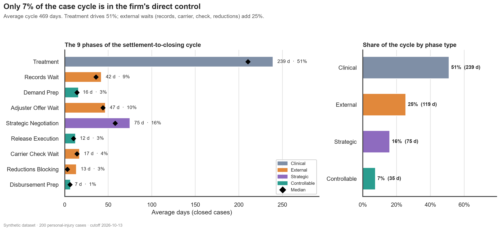
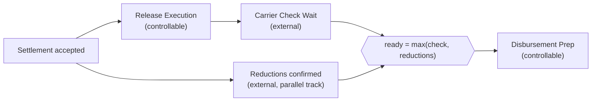
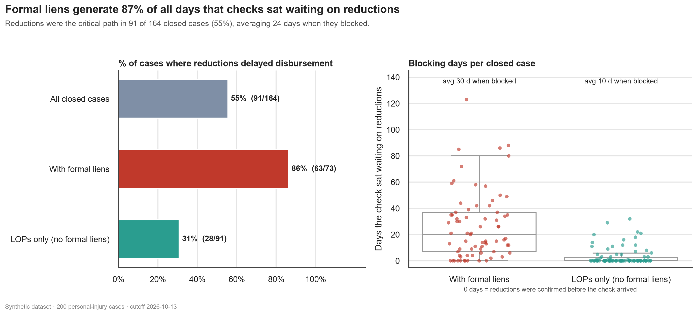
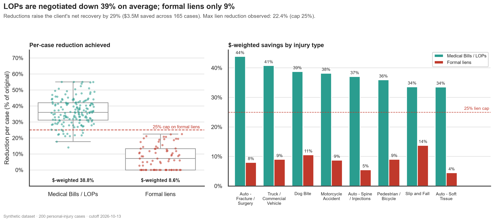
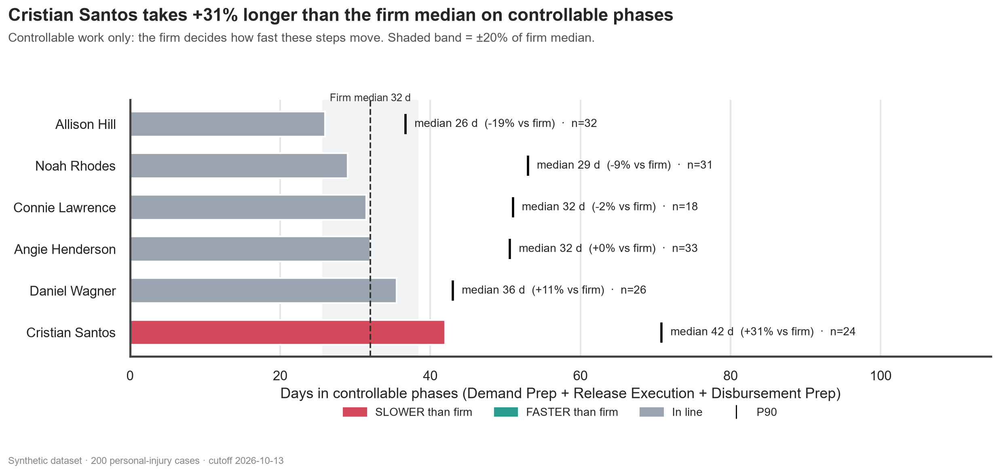
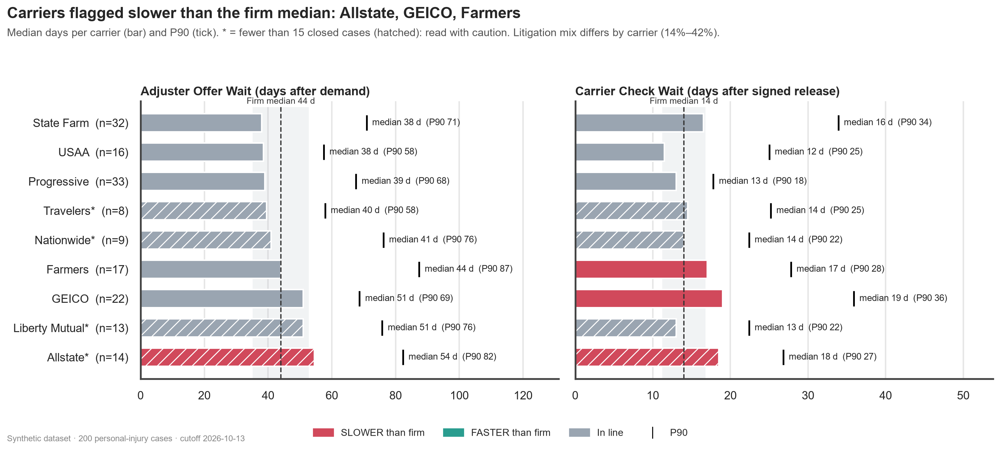
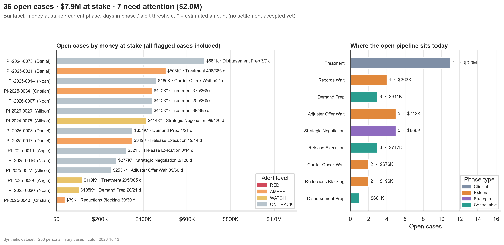
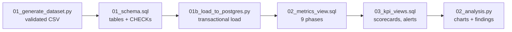

# Legal Operations & Analytics for Plaintiff-Side Personal Injury Firms

**Where does a PI case actually lose time between intake and the client's check, and how much of it can the firm control?**

An end-to-end analytics project built on PostgreSQL and Python: a synthetic 200-case portfolio, a 9-phase operating model that reconciles to the day, SQL KPI views, and six decision-ready charts. It focuses on the part of the lifecycle most dashboards lump into one "closing" bucket: **settlement to disbursement**, where a release, a carrier check, and medical-debt reductions all race in parallel.

> **Data note:** every record is synthetic (generated with a fixed seed). There is no client data, and every person and carrier name is fictitious. See [Limitations](#limitations-and-honest-caveats) for what that means for the findings.

---

## Headline findings

| | Finding |
|---|---|
| **Cycle time** | Average cycle is **469 days** (median 434). Only **7.5% (35 days)** is in the firm's direct control; Treatment is 51%, external waits 25%, strategic negotiation 16%. |
| **Critical path** | Medical-debt reductions delayed disbursement in **91 of 164 closed cases (55%)**, for an average of **24 days** with the check already in hand. |
| **Formal liens** | Cases with formal liens were blocked **86%** of the time vs **31%** for LOPs-only cases, and they account for **87% of all blocking days**. |
| **Savings** | Medical Bills / LOPs were reduced **38.8%** on average vs **8.6%** for formal liens (max observed 22.4%, under the 25% cap). Reductions raise the client's net recovery by **29.2%** (~$3.5M). |
| **Scorecards** | One case manager runs **+31%** slower than the firm median on controllable phases (42 vs 32 days). Three carriers are flagged slower on offer or check timing; one has a small sample. |
| **Open cases** | 36 open cases, **$7.9M** at stake, **7 flagged** ($2.0M): 4 AMBER and 3 WATCH, ranked by money at stake. |



---

## The operating model

Instead of one generic "closing" phase, the model uses **9 phases** with explicit ownership:

| # | Phase | Type | Avg days | Median | P90 | % of cycle |
|---|---|---|---:|---:|---:|---:|
| 1 | Treatment | Clinical | 239.3 | 210.5 | 442.1 | 51.1% |
| 2 | Records Wait | External | 42.2 | 36.0 | 71.0 | 9.0% |
| 3 | Demand Prep | **Controllable** | 15.8 | 14.0 | 25.7 | 3.4% |
| 4 | Adjuster Offer Wait | External | 46.8 | 44.0 | 75.7 | 10.0% |
| 5 | Strategic Negotiation | Strategic | 74.9 | 58.0 | 164.7 | 16.0% |
| 6 | Release Execution | **Controllable** | 12.4 | 10.0 | 19.0 | 2.7% |
| 7 | Carrier Check Wait | External | 17.0 | 14.0 | 28.7 | 3.6% |
| 8 | Reductions Blocking | External | 13.4 | 3.0 | 38.4 | 2.9% |
| 9 | Disbursement Prep | **Controllable** | 6.7 | 6.0 | 10.0 | 1.4% |

*Closed cases only (n = 164). Percentages are rounded. The type split is 51% Clinical, 25% External, 16% Strategic, 7.5% Controllable.*

### The post-settlement critical path

After a settlement is accepted, two tracks run **in parallel**. Disbursement can start only when both are done:



The key modeling decision is how to count the parallel track without double-counting days:

```
Reductions Blocking = max(0, reductions_confirmed - check_received)     -- days the check sat waiting
Disbursement Prep   = disbursement - max(check_received, reductions_confirmed)
```

The nine phases then **telescope exactly** into the total: `sum(9 phases) = disbursement_date - intake_date`. This identity is enforced in SQL and verified on all 164 closed cases (0 days of difference). The full parallel wait (`reductions_confirmed - settlement_accepted`) is kept as an informational column, not as a phase.

### Two kinds of medical debt, modeled differently

| | Formal liens | Medical Bills / LOPs |
|---|---|---|
| Examples | Medicare, Medicaid, ERISA, hospital liens | Chiropractors, imaging centers, specialists under a Letter of Protection |
| Negotiation room | Rigid; modeled with a **hard 25% cap** | Wider; modeled around 30-40%+ |
| Observed (this dataset) | 8.6% $-weighted | 38.8% $-weighted |

---

## Findings in detail

### Where the time goes is mostly not in the firm's hands
Treatment alone is half of the cycle, and every external wait (records, carrier offer, carrier check, reductions) adds another quarter. The three controllable phases total 35 days. Improving them is worthwhile, but it cannot move the headline number much: the larger levers are starting external processes earlier.

### Reductions are the most common bottleneck after settlement, and formal liens drive it


- The check arrived **before** the reductions in 91 cases (the critical-path driver) and **after** in 71 (2 ties).
- With formal liens: 63 of 73 cases blocked, averaging **30.5 days**. LOPs-only: 28 of 91 blocked, averaging **10.0 days**.
- Upper bound on the prize: eliminating all blocking would shorten the average cycle by 13.4 days (2.9%). The benefit to clients, who wait for cash, is larger than that percentage suggests.

### Reductions save real money, and the two debt types behave very differently


- LOPs: 38.8% average reduction, ranging from 43.9% (fracture/surgery) to 33.5% (soft tissue).
- Formal liens: 8.6% average; the largest observed reduction is 22.4%, so **0 cases exceed the 25% cap**.
- Net to client rises 29.2% because of reductions: $3.5M of total savings across 165 cases.

### Operational scorecards


Median days in controllable phases (Demand Prep + Release Execution + Disbursement Prep) vs the firm median of 32 days:

| Case manager | Closed cases | Median days | vs firm | Flag |
|---|---:|---:|---:|---|
| Allison Hill | 32 | 26.0 | -19% | In line |
| Noah Rhodes | 31 | 29.0 | -9% | In line |
| Connie Lawrence | 18 | 31.5 | -2% | In line |
| Angie Henderson | 33 | 32.0 | 0% | In line |
| Daniel Wagner | 26 | 35.5 | +11% | In line |
| **Cristian Santos** | 24 | **42.0** | **+31%** | **SLOWER than firm** |



Carrier timing vs the firm median (offer wait 44 days, check wait 14 days):

- **Allstate:** offer wait 54.5 days and check wait 18.5 days, both flagged slower. Only 14 closed cases, so treat it as a lead, not a verdict.
- **GEICO:** check wait 19.0 days (22 cases). **Farmers:** check wait 17.0 days (17 cases).
- Litigation share varies from 14% to 42% across carriers, so case mix may explain part of the offer-wait differences.

### Open cases: who to chase first


Each open case is placed in its current phase from its NULL pattern, then compared with that phase's alert threshold (thresholds sit near the P75 of closed-case durations). Ranking is by money at stake: the accepted settlement when it exists (8 cases), otherwise an estimate (28 cases, marked with `*` in the chart).

| Rank | Case | Manager | Level | Phase | Days / threshold | At stake |
|---:|---|---|---|---|---:|---:|
| 2 | PI-2025-0031 | Daniel Wagner | AMBER | Treatment | 406 / 365 | $503K |
| 4 | PI-2025-0034 | Cristian Santos | AMBER | Treatment | 375 / 365 | $440K |
| 7 | PI-2024-0075 | Allison Hill | WATCH | Strategic Negotiation | 98 / 120 | $414K |
| 9 | PI-2025-0017 | Daniel Wagner | AMBER | Release Execution | 19 / 14 | $349K |
| 24 | PI-2025-0039 | Angie Henderson | WATCH | Treatment | 295 / 365 | $119K |
| 27 | PI-2025-0030 | Noah Rhodes | WATCH | Demand Prep | 20 / 21 | $105K |
| 33 | PI-2025-0040 | Cristian Santos | AMBER | Reductions Blocking | 39 / 30 | $39K |

---

## Interactive dashboard: live case alerts

`app.py` is a Streamlit app that reads the same PostgreSQL views (not the CSV), so the dashboard, the charts and the SQL always agree. It answers one question: **which open cases need attention today, and who owns them?**


- **Alert queue:** every open case ranked by money at stake (or by severity, or by days over the threshold), with a progress bar showing how much of its phase threshold it has used. Click a row to open the case: money and fee at stake, days in phase, its manager's and carrier's scorecard flags, a chart of its time per phase against the firm median, and the recommended next action.
- **Filters:** case manager, carrier, injury type, case stage, current phase, alert level, accepted vs estimated amount and a minimum amount. KPI cards recalculate with every filter, and the filtered queue exports to CSV.
- **What-if thresholds:** scale all thresholds, or change where WATCH and RED begin, and watch the alert counts move. The database is not modified; with the switch off, the page reproduces `pi.v_open_case_alerts` exactly.
- **Risk map and owners:** a bubble chart of money vs threshold used, and per-manager and per-carrier open load next to their closed-case scorecards.


```powershell
pip install -r requirements.txt
streamlit run app.py        # run it from the project root, with the same PG* environment variables
```

**Verification:** the app was exercised headlessly (filters, sorting, what-if, empty results, database down, blocked driver) and in a real browser, and its figures were cross-checked against independent SQL for five scenarios. Streamlit depends on `pyarrow`, a compiled package: on a locked-down Windows machine, run `python -c "import pyarrow"` first. If it is blocked, the CLI pipeline and charts above still work, since they do not need it.

---

## What I would recommend if these were a real firm's numbers

These follow from the analysis. Each one should be validated against real data before acting (see Limitations).

1. **Open the reductions track earlier, and start with formal liens.** Reductions are on the critical path in 55% of cases, and formal liens generate 87% of the blocking days. Request final lien amounts at demand time instead of after acceptance, and record a *"reductions requested"* date so the time saved can be measured.
2. **Run formal liens as their own workstream.** 73 of 164 cases (45%) carry formal liens. Give them dedicated follow-up cadences and response-time tracking by lienholder; the LOP playbook (30-40% targets) does not transfer to them.
3. **Set carrier escalation rules at the thresholds already in the model.** A check wait beyond 21 days, or an offer wait beyond 60, goes to the carrier's supervisor. Watch GEICO and Farmers on checks and Allstate on both, once more cases accumulate.
4. **Review workload before judging performance.** The +31% gap for one manager is large but comes from 24 cases without adjusting for case mix. Compare case mix and load first, then learn from the fastest manager's workflow.
5. **Triage alerts weekly, with owners by phase type.** Controllable phases (Demand Prep, Release, Disbursement) are internal actions. External phases need an escalation, not just a reminder. WATCH cases (80% of threshold) are the cheapest ones to rescue.
6. **Do not expect the controllable phases alone to transform cycle time.** They are 7.5% of the cycle. Larger levers are pre-requesting records during treatment (Records Wait is 9%) and managing treatment duration with the client.
7. **Revisit the LOP playbook for soft-tissue and slip-and-fall cases.** They show the lowest average reductions (about 33-34% vs 44% for fracture/surgery), so they are the first place to look for negotiation upside.

---

## Data and design

### Synthetic dataset
200 cases (164 closed, 36 open as of the cutoff date **2026-10-13**), 8 injury types, 9 carriers, 6 case managers, intake dates from January 2023 to September 2026, 30% in litigation (40% fee) and 70% pre-suit (33% fee). Open cases carry realistic NULLs in milestones not yet reached, and amounts appear only once the milestone that reveals them has happened.

The generator deliberately builds in realistic frictions: one slower case manager, carriers with different offer and check speeds, outlier events (lost records, misplaced checks, unreachable clients), and slower reduction timelines when formal liens exist. Open cases are sampled with **length-biased sampling**: in a real snapshot you are more likely to find a case stuck in a long phase, so a uniform draw would understate stalled cases.

### Pipeline



### Project structure

```
.
├── app.py                            # Streamlit dashboard: live case alerts
├── .streamlit/config.toml            # demo settings (no telemetry, minimal toolbar)
├── data/pi_cases.csv                 # synthetic dataset (21 columns)
├── python/
│   ├── 01_generate_dataset.py        # generator with strict validations
│   ├── 01b_load_to_postgres.py       # pandas loader, transactional, self-verifying
│   ├── 02_analysis.py                # reads the SQL views, builds charts and findings
│   └── db_conn.py                    # shared connection, driver-agnostic error handling
├── sql/
│   ├── 01_schema.sql                 # schema, pi_cases with CHECKs, report_params
│   ├── 01b_constraint_tests.sql      # optional: proves the CHECKs reject bad data
│   ├── 02_metrics_view.sql           # v_case_phases (9 phases) + reconciliation
│   └── 03_kpi_views.sql              # 7 KPI views
├── images/                           # the six charts + dashboard screenshots
├── outputs/key_findings.md           # findings with figures computed from the database
└── requirements.txt
```

### Data quality: five layers of checks

1. **Generator:** chronological order, reduction caps, financial sanity (net to client must be positive) and phase-sum reconciliation are asserted before the CSV is written.
2. **Database constraints:** 19 named `CHECK` constraints (plus the primary key) enforce strict date ordering with NULL cascades, "disbursement requires both the check and the confirmed reductions", the 25% lien cap, and consistency between amounts and milestones.
3. **Constraint tests:** 7 deliberately invalid rows (e.g., a 30% lien reduction, a disbursement without reductions) must each be rejected by the exact expected constraint.
4. **Reconciliation view:** `v_reconciliation_check` must show zero differences; the SQL script fails if it does not.
5. **Loader:** a single transaction that compares row counts, per-column NULL counts and dates against the CSV, and rolls back on any mismatch.

Outputs are also deterministic: fixed seeds, and the same findings and charts come out byte-for-byte whichever PostgreSQL driver is used.

### Alert logic
`WATCH` at 80% of the phase threshold, `AMBER` above it, `RED` above 1.5x. Thresholds, the cutoff date and scorecard parameters live in the `pi.report_params` table, not in code. The cutoff date is always read from that table, never from `CURRENT_DATE`.

---

## How to run

**Requirements:** Python and PostgreSQL. Developed and tested with Python 3.12 and PostgreSQL 16; the SQL uses only standard features that should also work on PostgreSQL 13+, but older versions were not tested.

```powershell
python -m venv .venv
.\.venv\Scripts\Activate.ps1
pip install -r requirements.txt

# 1. Generate the dataset
python python/01_generate_dataset.py

# 2. Create the database once, then the schema (psql, or any SQL client: select the whole file and run)
createdb pi_analytics
psql -d pi_analytics -f sql/01_schema.sql

# 3. Load and verify the CSV
$env:PGUSER = "postgres"; $env:PGPASSWORD = "your_password"     # plus PGHOST / PGPORT / PGDATABASE if needed
python python/01b_load_to_postgres.py

# 4. (optional) Check that the constraints reject bad data
psql -d pi_analytics -f sql/01b_constraint_tests.sql

# 5. Build the views
psql -d pi_analytics -f sql/02_metrics_view.sql
psql -d pi_analytics -f sql/03_kpi_views.sql

# 6. Charts and key findings
python python/02_analysis.py

# 7. Interactive dashboard (opens http://localhost:8501)
streamlit run app.py
```

On macOS/Linux, replace the activation line and `$env:` lines with `source .venv/bin/activate` and `export PGUSER=...`.

**Driver note:** the project uses `pg8000`, a pure-Python PostgreSQL driver with no compiled extensions, because Windows Application Control policies can block binary drivers such as `psycopg2`. Set `PI_DB_DRIVER=psycopg` or `psycopg2` to use another driver. The SQL files contain no `psql`-only commands, so they run in SQLTools, DBeaver or pgAdmin as well.

---

## Limitations and honest caveats

- **The data is synthetic, and some patterns are planted.** The generator includes one slower manager, slower carriers and slower reductions for formal liens. The analysis recovering them shows the pipeline works; it is **not** evidence about how real PI firms behave. Real benchmarks need real data.
- **Small samples, no statistics.** Segments have 8-33 closed cases. Scorecards show medians and flags, but no confidence intervals or significance tests, and they do not adjust for case mix (injury severity, litigation, carrier). Low-sample segments are labeled.
- **The reduction rules are modeling assumptions.** A hard 25% cap on formal liens and a 30-40% range for LOPs are simplifications. Actual outcomes depend on state law, payer rules (Medicare, Medicaid, ERISA plan terms) and the specific provider. Nothing here is legal advice.
- **No "reductions requested" date exists.** The model can measure how long reductions block disbursement, but not how many days would be saved by starting earlier. Recommendation 1 would require capturing that milestone.
- **Money at stake is partly estimated.** For 28 of 36 open cases no settlement exists yet, so the amount is estimated from similar closed cases (marked in the output).
- **Simplified economics.** The attorney fee is applied to the gross settlement; case costs, expenses and other deductions are not modeled.
- **Alert thresholds are initial values** near the P75 of this synthetic data, and would need calibration against a firm's own history.

---

## Next steps

- Survival analysis (Kaplan-Meier) so that open cases count as censored observations instead of being excluded from time metrics.
- Bootstrap confidence intervals and case-mix adjustment for manager and carrier comparisons.
- Scheduled refresh and e-mail digests of newly flagged cases.
- An adapter to load a real firm's case-management export into the same schema.

## Skills demonstrated

Legal operations process modeling (critical path, controllable vs external time) · PostgreSQL (constraints, views, window functions, `percentile_cont`, `FILTER`, `LATERAL`, `DO` blocks) · Python data engineering (pandas, SQLAlchemy, transactional loads) · synthetic-data design with controlled realism · data-quality engineering · data visualization (matplotlib, seaborn, Altair) · interactive dashboards (Streamlit) · analytical communication and honest scoping.

---

## About

**William Perez** — 4 years in plaintiff-side Personal Injury operations (case management, settlement coordination, legal operations).
[LinkedIn](www.linkedin.com/in/williamperez232) · [Email](mailto:williamperezesp232@gmmail.com)

*This project uses no real client data and is for demonstration purposes only.*